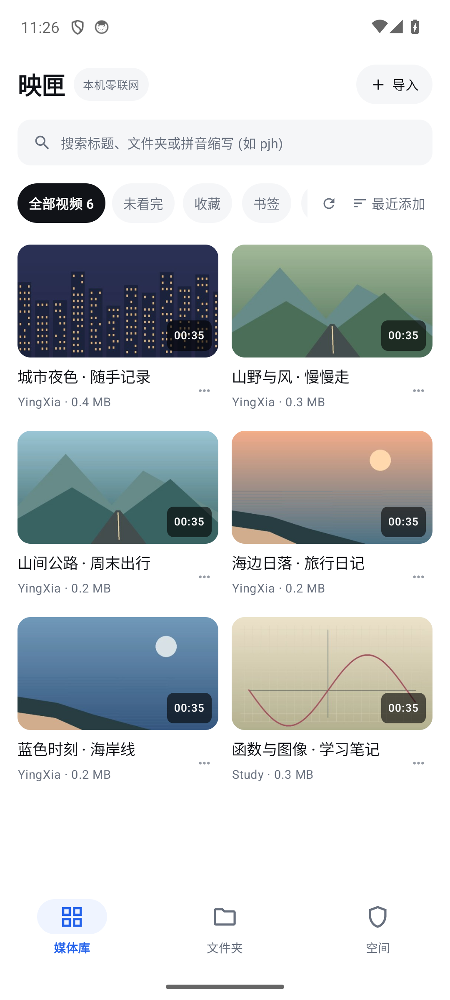
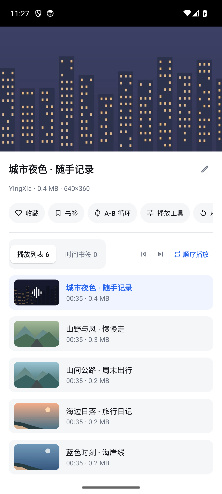

# YingXia Player · 映匣

[简体中文](README.md) · Android 8.0 and later · [MIT license](LICENSE)

I built YingXia because finding yesterday’s screen recording meant scrolling past a gallery full of photos and screenshots. Open the app, pick a video, and resume where you left off. **Playback, search, and vault encryption run on your phone. No account is required.**

**[Download YingXia 1.7.4 for Android](https://github.com/QAQ-cmyk/yingxia-player/releases/download/v1.7.4/YingXia-1.7.4.apk)** · [Release notes and checksums](https://github.com/QAQ-cmyk/yingxia-player/releases/tag/v1.7.4)

| Find a recording | Resume playback |
| :---: | :---: |
|  |  |

## On your first run

1. **Pick a video.** Grant gallery access or tap **打开本地视频** to open a single file in the system picker. The app interface is in Chinese.
2. **Watch at your own pace.** Hold to speed up and release to return to your usual speed. Swipe to seek, bookmark a timestamp, or loop a few seconds of a lecture with A–B repeat.
3. **Keep a private recording.** Go to **我的 → 加密保险箱** (Me → Encrypted vault) and set a separate password. YingXia encrypts and verifies a copy before asking to remove the gallery original. Resume, speed controls, and bookmarks also work inside the vault.

[Folder view](docs/screenshots/03-folders.png) · [Vault entry](docs/screenshots/04-profile.png)

## Where do my videos go?

| Action | What happens on your phone |
| --- | --- |
| Play or hide a video | The original stays in its folder. Hiding filters the app’s lists. The system gallery can still display the file. |
| Share from your gallery (1.7.4) | Select videos in your gallery and choose **Share → 映匣**. Watch a single video without saving history, or unlock the vault to save verified, encrypted copies of one or more videos. Sharing keeps the originals. Each vault entry shows where you can manage its original. |
| Watch once without saving history (1.7.3) | Open the video’s ⋮ menu, or long-press one video, and choose **本次不记播放记录**. It starts from the beginning and preserves your saved position and history order. Tap the video normally next time to resume saving progress. |
| Lock the vault during playback (1.7.3) | Tap **锁箱** on the right of the video to stop playback, lock the vault, and return to Home. The action is also available in full screen, with touch lock on, and in playback tool panels. Opening the vault again requires unlocking it. |
| Move a video into the vault | The video, its name, and private playback records are encrypted in app-private storage. Playback decrypts on demand. Leaving the app locks the vault. If you decline removal, the gallery keeps its copy. |
| Enter the wrong password | The encrypted files stay on disk. In 1.7.2, unlock the vault and write three recovery questions of your own, then enter an answer for each. You can also use or edit a suggested question. Answer those same questions on the same phone to set a new password. Without prior setup, the original password is required. |
| Switch phones or uninstall | Unlock the vault, select **恢复到相册** (Restore to gallery), then copy the restored videos to storage you control. Uninstalling or clearing app data deletes the vault. The ordinary records backup excludes it. |

The release APK requests no internet permission. There are no accounts, ads, or analytics. Your gallery’s cloud sync, its trash, and files you choose to share with other apps are managed separately. [Security details](SECURITY.md) · [Verify the APK](CONTRIBUTING.md#verify-the-apk)

## Contribute

YingXia is built with Kotlin, Jetpack Compose, and Media3. A playback bug report with your Android version, a device test, or a small usability fix is a good first contribution. [Build and contribute](CONTRIBUTING.md) · [Report an issue](https://github.com/QAQ-cmyk/yingxia-player/issues/new/choose)

If YingXia made your recordings easier to find, a **GitHub Star** helps others discover it.
