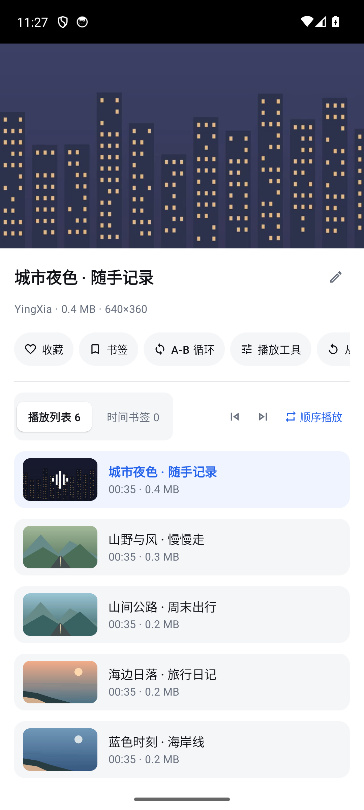
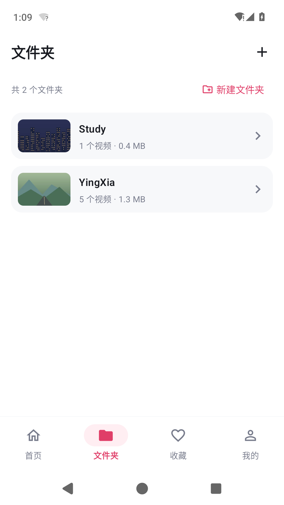
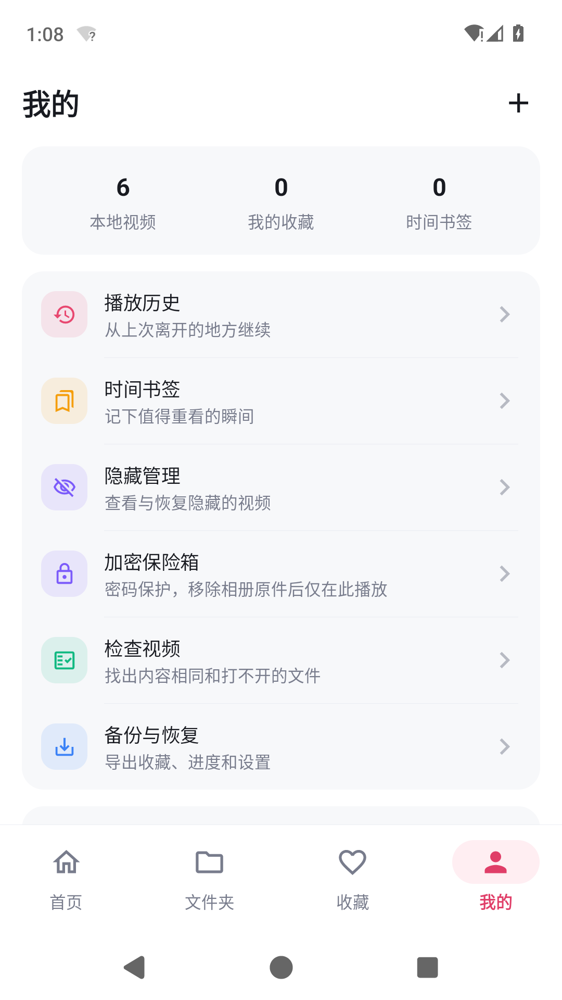
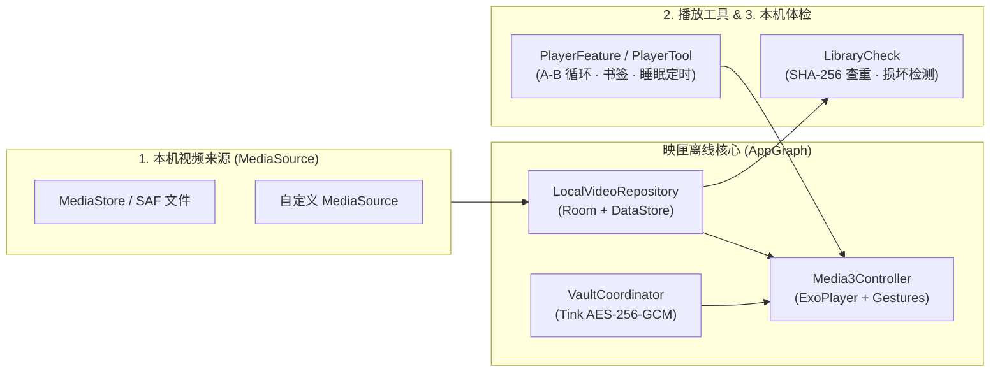

<div align="center">


# 映匣 · YingXia Player

**零联网权限 · 本地流式加密保险箱 · 清爽纯粹的 Android 本地视频播放器**

[-3DDC84?logo=android&logoColor=white)](https://github.com/QAQ-cmyk/yingxia-player/releases)
[](https://kotlinlang.org/)
[](https://developer.android.com/compose)
[](https://developer.android.com/media/media3)
[-E03E68)](#为什么做映匣)
[](LICENSE)

<p align="center">
  <a href="https://github.com/QAQ-cmyk/yingxia-player/releases/download/v1.6.1/YingXia-1.6.1.apk"><strong>📦 下载正式安装包 (v1.6.1 APK)</strong></a>
  &nbsp;·&nbsp;
  <a href="https://github.com/QAQ-cmyk/yingxia-player/releases/tag/v1.6.1">📋 1.6.1 更新说明</a>
  &nbsp;·&nbsp;
  <a href="https://github.com/QAQ-cmyk/yingxia-player/releases/download/v1.6.1/YingXia-1.6.1-source.zip">🗂️ 下载源码包</a>
  &nbsp;·&nbsp;
  <a href="docs/加密保险箱.md">🔐 保险箱加密规范</a>
</p>

</div>

---

## ✨ 界面预览

| 极简视频画廊（首页） | 清爽播放与加长进度条 | 智能文件夹封面视图 | 随身放映室与加密保险箱 |
| :---: | :---: | :---: | :---: |
|  |  |  |  |

---

## 🎯 为什么做映匣

映匣是一个**完全离线**的 Android 本地视频播放器。它给想把片子留在自己手机里的人用：**没有账号、不申请任何联网权限、不上传观看记录，也不夹带广告或统计 SDK**。打开飞行模式，播放、整理、加密、备份和文件体检都可以完整运行。

它不打算在冷门编码格式覆盖上和 VLC 或 MX Player 比全能；能在这台手机上正常打开的本地视频，用一套**干净、顺手、没有弹窗打扰的中文界面**看完，就够了。

| 特性维度 | 映匣 (YingXia Player) | 常见商业播放器 |
| :--- | :--- | :--- |
| **网络与隐私权限** | **0 联网权限**（`AndroidManifest` 彻底移除 `INTERNET` 与 `ACCESS_NETWORK_STATE`） | 申请完整网络权限、后台遥测、开屏或贴片广告 |
| **加密保险箱** | **Tink Streaming AES-GCM + PBKDF2**，内存中边解密边播，**绝不落盘明文临时文件** | 多为简单修改文件后缀或移入 `.nomedia` 隐藏目录 |
| **中文搜索与排序** | 原生支持**中文拼音首字母搜索**（如搜 `pjh` → 匹配「啤酒花」）与拼音序排列 | 仅支持完整汉字子串匹配 |
| **观影与学习工具** | **超长进度条**、**A-B 区间循环**、**带备注时间书签**、**长按 2×/3× 加速**、**双指缩放 & 裁黑边** | 高级学习工具常需付费解锁或藏在深层菜单 |
| **本机文件体检** | 离线 **SHA-256 内容查重** + 损坏/不可读视频检测（仅报告，不擅自删文件） | 极少提供内容级哈希查重 |
| **数据迁移与备份** | 收藏、进度、书签、设置一键导出为**可读 JSON 纯文本**，零云端绑定 | 绑定专有云账号，离线难以迁移 |

---

## 🚀 核心功能亮点

### 1. 🔒 彻底离线与硬件级流式加密保险箱
- **清单级断网保证**：构建阶段用 `tools:node="remove"` 显式剥离 `android.permission.INTERNET` 及 Media3 默认附带的 `ACCESS_NETWORK_STATE`，从根源上杜绝任何数据外发可能。
- **流式加密保险箱（v1.6.1）**：
  - 采用 **PBKDF2-HMAC-SHA256**（210,000 次迭代）派生主密钥，配合 Google Tink **Streaming AEAD (`AES256_GCM_HKDF_1MB`)** 对视频进行分块认证加密。
  - **先校验、后移除**：导入时先写入密文并完整回读校验通过，再通过系统 `MediaStore.createDeleteRequest` 请求移除相册原件；取消系统授权不会误删原件。
  - **零明文落盘播放**：基于自定义 Media3 `VaultDataSource`，按 1MB 密文分块在内存中实时解密并校验 GCM 标签，无需生成任何明文临时文件即可毫秒级拖动进度。
  - **防截屏与后台秒锁**：保险箱全程开启 `FLAG_SECURE` 阻止截屏/录屏与最近任务预览；切到后台或锁屏瞬间清零内存密钥并自动锁定。

### 2. 🎬 清爽播放控制与精看学习工具
- **加长进度条与防误触布局**：视频底部控制栏仅保留「播放/暂停 + 超长进度条 + 时间 + 全屏」，大幅增加手指拖拽精度；切集按钮移至播放列表栏与全屏顶栏。
- **全手势操控**：
  - 单击显隐控制层，双击播放/暂停，水平滑动预览并跳转进度（中途取消手势绝不误跳）。
  - 长按画面任意位置触发 **2× / 3× 临时加速**，松手即恢复原倍速；支持 0.5× ~ 3.0× 八档常驻倍速记忆。
  - 全屏左侧上下滑调节亮度，右侧上下滑调节音量；双指捏合自由放大平移画面（与进度/亮度手势严格互斥）。
  - 开启**防误触锁**后先拦截单击与滑动，点按左侧锁扣即可解开。
- **A-B 区间循环 & 时间书签 & 睡眠定时**：
  - 在需要反复观摩的片段标记 A 点与 B 点即可无限区间循环。
  - 随时为当前时间戳添加文字备注书签，一键跳回关键画面。
  - 支持 15 / 30 / 60 / 90 分钟倒计时暂停，或勾选「**播完当前后暂停**」。

### 3. 🗂️ 极简画廊、拼音搜索与本机体检
- **无框画廊式首页**：去繁就简的留白网格、轻量胶囊搜索条、单行快速续播提示，首屏即可一览更多视频封面。
- **拼音首字母检索**：同时匹配显示名称、原文件名与所属文件夹名，支持汉字与拼音首字母混搜。
- **本地文件夹管理**：自动聚合手机存储中的视频目录并提取首帧封面；支持在应用内新建文件夹、跨目录安全移动（复制并完整校验后才移除原文件）与批量管理。
- **SHA-256 重复与损坏体检**：「我的 → 检查视频」在本地比对文件 SHA-256 找出内容完全一致的重复副本，并利用 `MediaMetadataRetriever` 排查无法解码的损坏文件。

---

## 🧩 架构与编译期扩展设计

映匣不搞复杂的插件商店或动态加载外部 APK，所有扩展点均通过清晰的 Kotlin 接口在编译期静态注册：



要在自己的分支里扩展功能，只需三步（接口定义见 `core/Models.kt` 与 `core/LibraryChecks.kt`）：
1. **新增本机视频来源**：实现 `MediaSource` 的 `query` 与 `resolve`，加入 `AppGraph.extraSources`。
2. **新增播放工具面板**：实现 `PlayerFeature`，在 `yingxiaTools()` 列表追加一项 `PlayerTool`（功能、图标、Compose 面板），播放器底部工具抽屉即自动展示入口。
3. **新增本机体检规则**：实现 `LibraryCheck` 并加入 `AppGraph.checks`，「检查视频」页面即会一并执行。

---

## 📥 安装与升级说明

- **直接安装**：前往 [Releases 页面](https://github.com/QAQ-cmyk/yingxia-player/releases/tag/v1.6.1) 下载 `YingXia-1.6.1.apk`（支持 Android 8.0 / API 26 及以上）。
- **覆盖升级注意**：`YingXia-1.6.1.apk` 使用与 `1.2.1`、`1.6.0` 相同的正式签名，可直接覆盖升级并保留全部数据。若此前安装过 `1.5.1-debug` 等调试签名包，遇到签名冲突时**请勿直接卸载旧版**——请先在旧版「我的 → 备份与恢复」导出普通记录，并将保险箱内视频恢复至相册后再安装正式版。详见 [安装与使用说明](delivery/v1.6.1-notes/安装与使用.md)。

---

## 🛠️ 本地构建与验证

环境要求：**JDK 17**、**Android SDK Platform 35**、**Build Tools 35.0.0**。在项目根目录创建 `local.properties` 并配置 `sdk.dir` 后执行：

```powershell
# 运行单元测试、Lint 检查并构建 Debug 安装包
.\gradlew.bat :app:testDebugUnitTest :app:lintDebug :app:assembleDebug
```

完整的版本说明、设备测试证据与 SHA-256 校验值均随仓库保存在 [`delivery/v1.6.1-notes/`](delivery/v1.6.1-notes/) 与 [`delivery/SHA256SUMS-1.6.1.txt`](delivery/SHA256SUMS-1.6.1.txt)。

---

## 📄 开源许可与支持

- 本项目基于 [MIT License](LICENSE) 开源，Copyright © 2026 [QAQ-cmyk](https://github.com/QAQ-cmyk)。
- 如果你喜欢这个**零联网、干净无打扰**的本地播放器，欢迎点亮右上角的 **⭐ Star** 支持项目，或分享给同样看重本机隐私的朋友！
