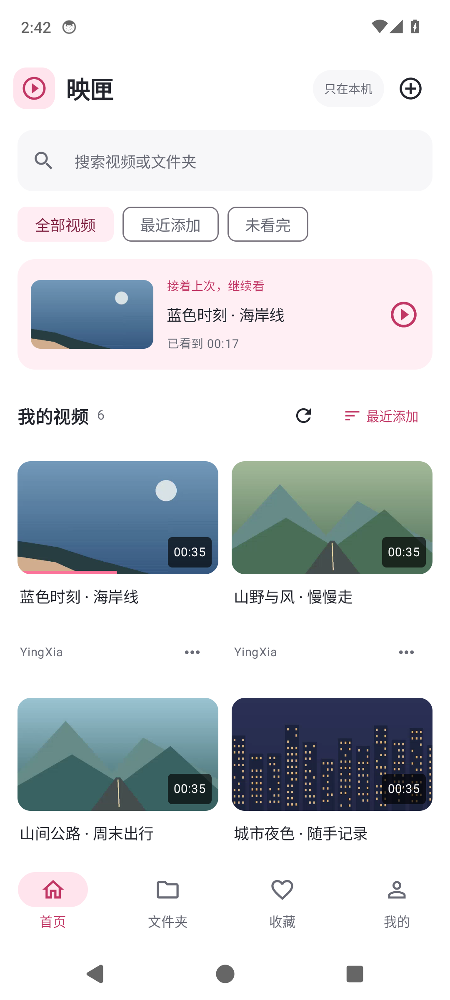
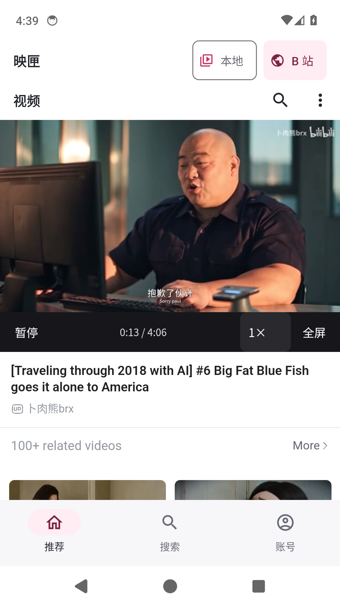
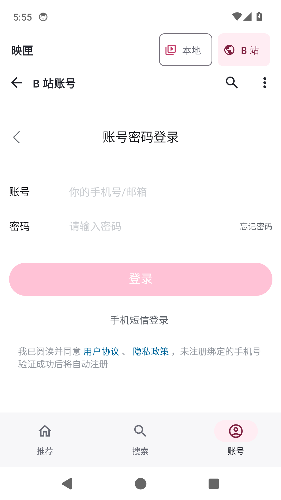

# 映匣 1.2.1

中文 Android 视频播放器，支持 Android 8.0（API 26）及以上。Kotlin + Compose + Media3，Room 保存关联记录，DataStore 保存偏好。本地功能离线使用；切换「B 站」后访问官方网站。

[下载 1.2.1 安装包](https://github.com/QAQ-cmyk/yingxia-player/releases/download/v1.2.1/YingXia-1.2.1.apk) · [版本发布页](https://github.com/QAQ-cmyk/yingxia-player/releases/latest) · [安装说明](delivery/安装与使用.md) · [测试记录](delivery/测试记录.md)

<p>
  
  
  
</p>

本地首页截图来自 1.0.0，在线播放截图来自 1.2.0，账号截图来自 1.2.1；详细版本范围见测试记录。项目为独立开发的播放器，与 B 站官方无隶属关系。

## 本次更新

- 修复点击「账号」后在登录表单出现前返回推荐/视频的路径：入口明确携带账号中心返回地址，未登录时显示官方登录页，已有会话时由官网直接转到账号中心。
- 账号页面按官方域名识别，避免视频网址的查询参数误切换账号标签；保留原有网页 Cookie。
- 修复小屏登录页中说明文字遮住密码登录入口的排版，保留全部官方表单与协议文字。

## 1.2.0 保留功能

- 修复网站自动唤起 App 导致「此链接不能在应用内打开」反复弹出的情况；有明确点击的视频 App 链接转为应用内页面。
- B 站改为推荐、搜索、账号三项底部导航，去掉地址行和重复网页导航。
- 推荐卡片直接打开应用内视频；播放、倍速和全屏控件位于原视频区域，移除「网页内播放」二层面板。
- 保留 1.1.0 的浅色长按提示、真实文件夹、批量移动及删除功能。

## 安装与交付

从 [Releases](https://github.com/QAQ-cmyk/yingxia-player/releases) 下载 `YingXia-1.2.1.apk`。沿用旧版签名，可直接覆盖升级保留记录，不要先卸载。发布页同时提供完整源码 ZIP 和 SHA-256 校验文件；截图、安装说明、接口说明和测试记录位于仓库的 `delivery/`。APK、打包源码和本机构建缓存不纳入 Git 历史。

本地视频不会上传。隐藏只影响应用内显示；「删除原文件」则会真正删除手机文件。在线模式使用系统 WebView，网页账户数据保存在其本机 Cookie/存储中，可手动清除。广告过滤不保证去除视频内植入或网站未来出现的所有广告。

## 保留的播放器功能

相册全部/部分授权、文件选择、搜索排序、文件夹、收藏；八档倍速、长按加速、进度拖动、互斥手势；全屏、亮度音量、锁定、续播和队列；SRT/VTT 与内嵌字幕、A-B 循环、时间书签、睡眠定时；批量隐藏恢复和深色模式。

## 构建

JDK 17、Android SDK Platform 35、Build Tools 35.0.0。使用 Android Studio 打开工程，在未提交的 `local.properties` 中设置 `sdk.dir=C:/Android/Sdk`。

```powershell
.\gradlew.bat :app:assembleDebug :app:assembleRelease :app:testDebugUnitTest :app:lintDebug
.\gradlew.bat :app:assembleDebugAndroidTest
.\scripts\device-tests.ps1 -Serial emulator-5554 -Sdk C:\Android\Sdk
```

Windows 建议英文路径。首次下载构建依赖需要网络；SDK、缓存、机器路径和签名私钥不包含在源码包中。签名材料保存在原工作区 `.tools/signing/`，由项目所有者单独保管。设备测试使用专门模拟器，不能为了调试测试卸载日常使用的正式包。

## 结构与依据

`core` 公共协议；`data` 媒体、记录与真实文件操作；`playback` 播放适配；`features` 注册功能；`online` 网站适配；`ui` 页面与手势。详情见 `docs/扩展接口.md` 和 `docs/网络功能参考.md`。

实际测试范围见 `delivery/测试记录.md`。模拟器结果不代表所有手机、编码格式或 B 站登录路径均已通过。
