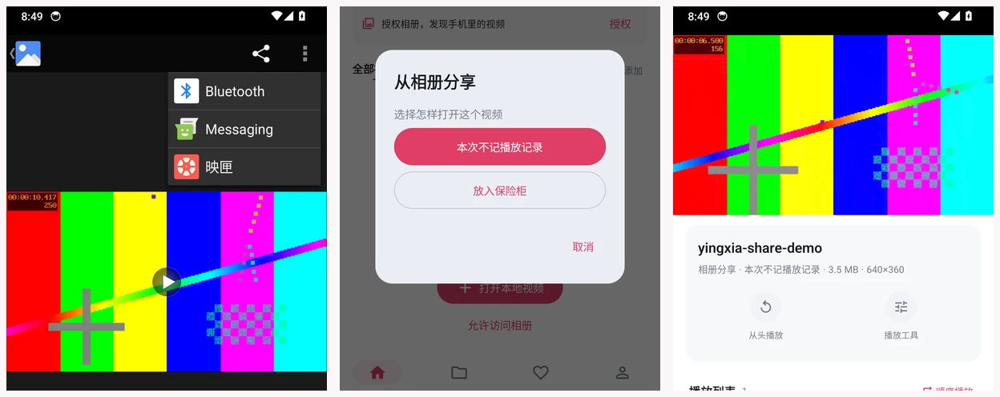
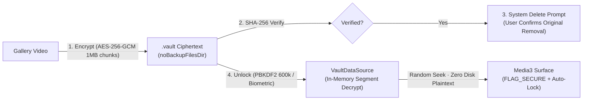

# YingXia Player · 映匣

[简体中文](README.zh-CN.md) · **[Download Latest APK (v2.0.4 · 4.16 MB)](https://github.com/QAQ-cmyk/yingxia-player/releases/latest)** · [Website](https://qaq-cmyk.github.io/yingxia-player/)

**A 4.16 MB, zero-internet-permission Android local video player with a real AES-256-GCM streaming encrypted vault.** Built with Kotlin, Jetpack Compose, Media3, and Google Tink — no ads, no accounts, no trackers, and zero plaintext cache files on disk.

[](https://github.com/QAQ-cmyk/yingxia-player/releases/latest)
[](https://github.com/QAQ-cmyk/yingxia-player/releases/latest)
[](scripts/check-apk-privacy.py)
[](.github.com/workflows/android.yml)
[](LICENSE)
[](https://github.com/QAQ-cmyk/yingxia-player/releases/latest)

---

## v2.0.4 Screenshots

| Minimalist 2-Column Library | Cohesive Light/Dark Player | 5-Step Hold-to-Boost Speed | Space & Encrypted Vault |
| :---: | :---: | :---: | :---: |
|  |  |  |  |

---

## Try It in 5 Seconds (Zero Library Permissions Needed)

Open any video in your Android gallery, tap **Share → YingXia**, and choose:
- **Watch without history** — plays from the beginning without touching your resume point or watch history.
- **Move to Encrypted Vault** — saves an AES-256-GCM encrypted copy straight into the local vault (you decide whether to keep or remove the original).



---

## Two Physically Isolated Editions

| Edition | Package ID | Size | Best For |
| :--- | :--- | :---: | :--- |
| **Offline Core (`YingXia-2.0.4.apk`)** *(Recommended)* | `cn.yingxia.player` | **4.16 MB** | Daily offline playback & private vault. **Zero `INTERNET` / `ACCESS_NETWORK_STATE` permissions and zero sync/network DEX classes.** |
| **Self-Hosted Sync (`YingXia-2.0.4-sync.apk`)** *(Optional)* | `cn.yingxia.player.sync` | **4.25 MB** | Installs alongside Offline Core. Connects to your own self-hosted Kotlin + Ktor `:server` for **HTTP 206 range streaming** and **client-side Zero-Knowledge E2EE sync** (progress, bookmarks & `.vault` cold backup — keys never leave your phone). |

---

## How the Encrypted Vault Works

Unlike vault apps that decrypt your entire video to a plaintext cache file before playback, YingXia wires a custom Media3 `VaultDataSource` straight into **Google Tink's `AES256_GCM_HKDF_1MB` Streaming AEAD** channel:



- **PBKDF2-HMAC-SHA256 (600,000 iterations) + Optional Hardware Biometric Unlock**: Wraps per-vault Tink keysets inside `keyset.bin`; optional Android Keystore `BiometricPrompt` unlock invalidates automatically on password changes.
- **Verify before removing originals**: Android's system delete confirmation is only requested *after* the ciphertext is fully written, fsynced, and SHA-256 verified. Declining keeps your gallery copy intact.
- **Uninstall-safe pure-ciphertext cold backup**: Bind any local folder (`Documents/YingXiaVault`) or USB OTG drive via SAF for an incremental pure-ciphertext mirror (zero plaintext videos, titles, or passwords). Reinstall or switch phones and restore directly with your vault password.
- **Zero metadata leakage & instant panic lock**: Vault titles, resume positions, favorites, crop state, and bookmarks live in separate AAD-authenticated ciphertext files (`.meta` / `.playback`). `FLAG_SECURE` blocks screenshots/screen recording, leaving the app locks immediately, and a one-tap **Lock** button on the vault player stops playback and returns home instantly.
- **Offline custom recovery questions**: Optional 3 custom questions protected by Android Keystore (with 5-attempt cooldown) for on-device password reset — zero servers involved.

Deep dive: [docs/VAULT_ARCHITECTURE.md](docs/VAULT_ARCHITECTURE.md) · [中文技术文档](docs/加密保险箱.md) · [Changelog](CHANGELOG.md) · [Security](SECURITY.md)

---

## Playback, Gestures & Local Library Features

- **5-step long-press boost + live slide-to-switch**: Choose your preferred default hold speed (`1.5× / 2× / 2.5× / 3× / 4×`) right inside the player speed sheet or Settings — and **slide left or right while holding** to switch boost speeds on the fly with haptic feedback (release to restore; never slows down if already playing faster).
- **Complete playback toolkit**: 8 remembered speeds (`0.25×`–`3×`), double-tap play/pause, swipe-to-seek preview, fullscreen brightness & volume gestures, pinch-to-zoom, crop black bars, **A–B segment loop**, **timestamped bookmarks with notes** (also inside the vault), **Watch without history**, sleep timer, and accidental-touch guard.
- **Minimalist 2.0 UI**: Monochrome + Slate Blue palette, 3-tab navigation (`Library / Folders / Space`, auto `NavigationRail` on tablets), guaranteed 2-column vertical-scrolling video grid on portrait phones, cohesive Light/Dark portrait player, floating continue-watching capsule, and floating multi-select action island.
- **Local-first utilities**: Instant search (with Chinese pinyin initials), verified local folder moves (SHA-256 checked before deleting source), offline SHA-256 duplicate & unreadable file scanner, password-encrypted local backups (`.yxbackup.enc`), and full **English / 简体中文** switching.

---

## Why Only 4.16 MB — And How to Verify Zero Network Permissions

v2.0 shrank the release APK from ~16 MB to **4.16 MB** by enabling R8 minification & resource shrinking and replacing third-party image/networking dependencies (Coil / OkHttp) with a pure-Android `LocalVideoThumbnails` in-memory `LruCache`.

In the offline core flavor, both `INTERNET` and `ACCESS_NETWORK_STATE` are stripped via `tools:node="remove"` in [`AndroidManifest.xml`](app/src/offline/AndroidManifest.xml), and cloud backups (`allowBackup`, `fullBackupContent`) are disabled. Every build runs an automated manifest + DEX bytecode privacy check, which you can audit yourself on any release APK:

```bash
python3 scripts/check-apk-privacy.py YingXia-2.0.4.apk
# PASS: network permissions absent; zero sync/network DEX classes; backup disabled; extraction rules declared; debugging disabled.
```

<details>
<summary><strong>Privacy & Data Boundaries (Please Read Before Storing Important Videos)</strong></summary>

| Action | What happens on your device |
| :--- | :--- |
| **Play or ordinary Hide** | The file stays in its folder. Ordinary Hide only filters YingXia's lists; your system gallery still shows it. |
| **Move to Encrypted Vault** | Video, display title, and private playback records are encrypted inside `noBackupFilesDir`. Cancelling the system delete prompt keeps the gallery original. |
| **Forget vault password** | Wrong passwords never delete files. If you enabled on-device recovery questions beforehand, answer all three on the same phone to reset the password; otherwise the original password is required. |
| **Uninstall or switch phones** | System cloud backup is intentionally disabled; **uninstalling deletes the local vault unless you bound a local/USB pure-ciphertext vault backup folder** or tapped **Restore to gallery** (`Movies/映匣恢复/`) beforehand. Always **install over** your existing version when upgrading. |

</details>

---

## Installation & Updates

- **GitHub Releases**: Download the signed `YingXia-2.0.4.apk` (or optional `YingXia-2.0.4-sync.apk`) and `SHA256SUMS` from [**Latest Release**](https://github.com/QAQ-cmyk/yingxia-player/releases/latest) (Android 8.0+). **Always install over your existing version when upgrading.**
- **Obtainium (Auto-updates)**: Add `https://github.com/QAQ-cmyk/yingxia-player` in [Obtainium](https://github.com/ImranR98/Obtainium) to track GitHub Releases automatically.
- **IzzyOnDroid / F-Droid**: Fastlane metadata and clean FOSS builds (`dependenciesInfo` disabled) are ready in-repo.
- **Build from source**: Requires JDK 17 and Android SDK 35. See [CONTRIBUTING.md](CONTRIBUTING.md).

---

## Roadmap

- [x] Zero `INTERNET` permission + automated CI manifest & DEX verification
- [x] AES-256-GCM Streaming AEAD encrypted vault (zero plaintext cache)
- [x] Hardware-backed Biometric (fingerprint) quick unlock & offline recovery questions
- [x] Uninstall-safe pure-ciphertext vault backup & `.yxbackup.enc` encrypted local backups
- [x] Minimalist 2.0 UI, 4.16 MB R8 slim build & 5-step live-slide long-press boost
- [x] Optional self-hosted Ktor `:server` (HTTP 206 streaming + Zero-Knowledge E2EE sync)
- [ ] External subtitle support (`SRT` / `VTT` / `ASS`)
- [ ] IzzyOnDroid & F-Droid store availability

---

## Contributing & Support

Bug reports, device compatibility feedback, translations, and pull requests are welcome:
- [Report a bug or request a feature](https://github.com/QAQ-cmyk/yingxia-player/issues/new/choose)
- [Build & Contribution Guide](CONTRIBUTING.md) · [Security Policy](SECURITY.md)

If YingXia gave you a cleaner offline video player or a trustworthy zero-network vault, **giving it a Star ⭐ helps independent open-source software get discovered.**
