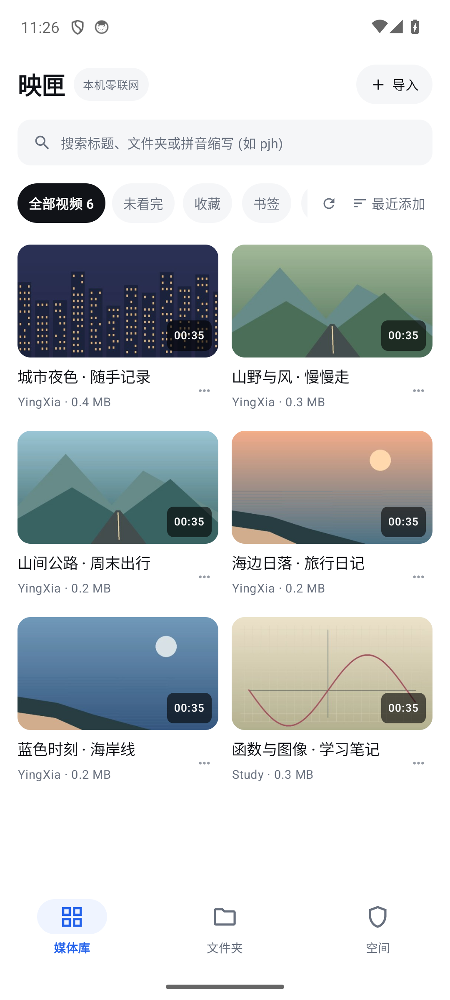
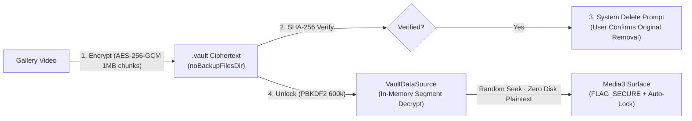

# YingXia Player · 映匣

[简体中文](README.zh-CN.md) · **[Download the Android APK](https://github.com/QAQ-cmyk/yingxia-player/releases/latest)**

I built YingXia because my screen recordings and downloaded videos kept getting buried among the photos on my phone. I wanted to find a clip, watch it, and pick up a longer video where I left off. YingXia runs entirely on your phone and requires no internet permission or account.

**Try it with one recording.** Open a video in your Android gallery, tap **Share → YingXia**, then choose **Watch without history** (本次不记播放记录). The clip starts from the beginning. Your previous resume point and the order of your viewing history stay as they were. You can share just that clip without granting access to your whole library.


For a private clip, the same menu can save an encrypted copy to the local vault. The original stays in your gallery until you choose to remove it.

[How vault encryption works](docs/VAULT_ARCHITECTURE.md) · [Changelog](CHANGELOG.md) · [Security](SECURITY.md)

[](https://github.com/QAQ-cmyk/yingxia-player/releases/latest)
[](https://github.com/QAQ-cmyk/yingxia-player/actions/workflows/android.yml)
[](scripts/check-apk-privacy.py)
[](LICENSE)
[](https://github.com/QAQ-cmyk/yingxia-player/releases/latest)

---

## Screenshots

| Home · Clean Library | Player · Gestures & Queue | Folders · Real Storage | Me · Vault & Library Check |
| :---: | :---: | :---: | :---: |
|  |  |  |  |

---

## How the Encrypted Vault Works

Unlike vault apps that decrypt your whole video into a plaintext cache file before playing, YingXia plugs a custom Media3 `VaultDataSource` directly into **Google Tink's `AES256_GCM_HKDF_1MB` Streaming AEAD** channel:



- **PBKDF2-HMAC-SHA256 (600,000 iterations)** wraps per-vault Tink keysets inside `keyset.bin`; passwords and clear keysets are never written to disk.
- **Verify before removing originals**: Gallery deletion is requested via Android's system dialog *only* after the ciphertext is fully written, synced, and SHA-256 verified. Declining keeps your gallery copy intact.
- **Zero metadata leakage**: Vault titles, resume positions, favorites, crop state, and bookmarks live in separate AAD-authenticated ciphertext files (`.meta` / `.playback`) — completely invisible to search, history, and JSON backups. No plaintext thumbnails are generated.
- **Instant background lock & one-tap panic lock**: `FLAG_SECURE` blocks screenshots/screen recording; leaving the app locks immediately, and a **Lock** button right on the vault player stops audio/video, locks the vault, and returns straight to Home in one tap.
- **Zero-library-permission gallery sharing**: Don't even want to grant full gallery read access? Select videos in your Android gallery → **Share → YingXia** to watch once without history or save encrypted copies straight into the vault.
- **Offline custom recovery questions**: Optionally configure three custom questions encrypted with Android Keystore (with 5-attempt cooldown) to reset a forgotten password locally on the same phone — zero servers involved.

Deep dive: [docs/VAULT_ARCHITECTURE.md](docs/VAULT_ARCHITECTURE.md) · [中文技术文档](docs/加密保险箱.md)

---

## Playback & Local Library Features

- **Effortless speed & gestures**: 8 speeds (`0.25×`–`3×`), **press-and-hold temporary 2×/3× boost** (release to restore), double-tap play/pause, swipe-to-seek preview, fullscreen brightness/volume gestures, pinch-to-zoom, crop black bars, and accidental-touch guard.
- **Built for lectures & private viewing**: **A–B segment loop**, **timestamped bookmarks** with notes (works both in normal library and inside the encrypted vault), **Watch without history** (one-time playback that preserves prior resume position), and **sleep timer** (countdown or pause at end of video).
- **Local-first utilities**: Instant search (with Chinese pinyin initials), verified local folder moves (SHA-256 checked before deleting source), offline SHA-256 duplicate & unreadable file scanner, and local JSON metadata backup/restore.
- **Bilingual UI**: Full **English** and **Simplified Chinese** interface — follows system language or switches instantly in **Me → Playback & Appearance**.

---

## Verify Zero Internet Permission Yourself

Both `INTERNET` and `ACCESS_NETWORK_STATE` are explicitly stripped via `tools:node="remove"` in [`AndroidManifest.xml`](app/src/offline/AndroidManifest.xml), and Android cloud backups (`allowBackup`, `fullBackupContent`) are disabled. Every commit runs our privacy check in [GitHub Actions](.github/workflows/android.yml), and you can audit any release APK yourself:

```bash
python3 scripts/check-apk-privacy.py YingXia-2.0.0.apk
# PASS: network permissions absent; zero sync/network DEX classes; backup disabled; extraction rules declared; debugging disabled.
```

<details>
<summary><strong>Privacy & Data Boundaries (Please Read Before Storing Important Videos)</strong></summary>

| Action | What happens on your device |
| --- | --- |
| **Play or ordinary Hide** | The file stays in its folder. Ordinary Hide only filters YingXia's lists; your system gallery still shows it. |
| **Move to Encrypted Vault** | Video, display title, and private playback records are encrypted inside `noBackupFilesDir`. Cancelling the system delete prompt keeps the gallery original. |
| **Forget vault password** | Wrong passwords never delete files. If you enabled on-device recovery questions beforehand, answer all three on the same phone to reset the password; otherwise the original password is required. |
| **Uninstall or switch phones** | System cloud backup and device migration are intentionally disabled; **uninstalling or clearing app data deletes the vault**. Unlock and tap **Restore to gallery** (`Movies/映匣恢复/`) before migrating. |

</details>

---

## Installation & Updates

- **GitHub Releases**: Download the signed `YingXia-*.apk` and `SHA256SUMS` from [**Latest Release**](https://github.com/QAQ-cmyk/yingxia-player/releases/latest) (Android 8.0+). **Always install over your existing version when upgrading** — uninstalling deletes the vault.
- **Obtainium (Auto-updates)**: Add `https://github.com/QAQ-cmyk/yingxia-player` in [Obtainium](https://github.com/ImranR98/Obtainium) to track GitHub Releases automatically.
- **IzzyOnDroid / F-Droid**: Fastlane metadata and clean FOSS builds (`dependenciesInfo` disabled) are ready in-repo; store submission is next on our roadmap.
- **Build from source**: Requires JDK 17 and Android SDK 35. See [CONTRIBUTING.md](CONTRIBUTING.md).

---

## Roadmap

Star ⭐ the repository to follow upcoming releases:

- [x] Zero `INTERNET` permission + automated CI manifest verification
- [x] AES-256-GCM Streaming AEAD encrypted vault (zero plaintext cache)
- [x] Offline custom recovery questions backed by Android Keystore
- [x] Full English & Simplified Chinese UI + in-app language switcher
- [x] Fastlane metadata & clean FOSS release configuration
- [x] Biometric (fingerprint / face) quick unlock option for the vault
- [ ] External subtitle support (`SRT` / `VTT` / `ASS`)
- [x] Encrypted portable vault export archive for effortless phone migration
- [ ] IzzyOnDroid & F-Droid store availability

---

## Contributing & Support

Bug reports, device tests, translations, and pull requests are warmly welcome!

- [Report a bug or request a feature](https://github.com/QAQ-cmyk/yingxia-player/issues/new/choose)
- [Build & Contribution Guide](CONTRIBUTING.md) · [Security Policy](SECURITY.md)

If YingXia gave you a cleaner offline video player or a trustworthy zero-network vault, **giving it a Star ⭐ really helps independent open-source software get discovered!**
