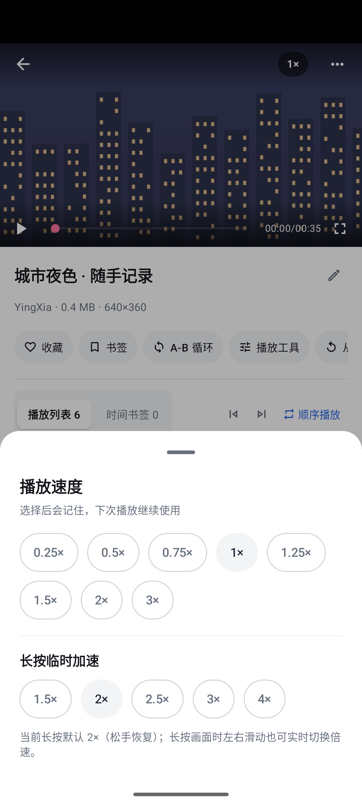
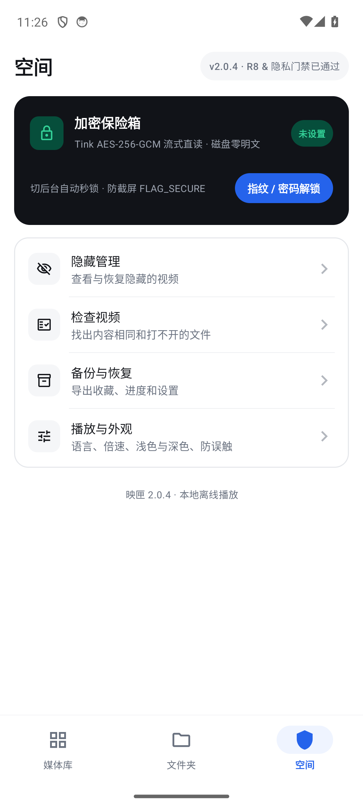
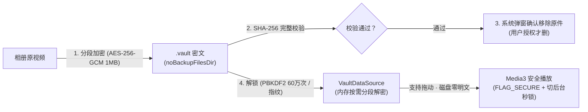

# 映匣 · YingXia Player

[English](README.md) · **[下载最新安卓安装包 (v2.0.4 · 4.16 MB)](https://github.com/QAQ-cmyk/yingxia-player/releases/latest)** · [项目主页](https://qaq-cmyk.github.io/yingxia-player/)

**仅 4.16 MB、零联网权限的开源 Android 本地视频播放器，内置真·流式 AES-256-GCM 加密视频保险箱。** 使用 Kotlin、Jetpack Compose、Media3 与 Google Tink 构建——无广告、无账号、无统计埋点，播放加密视频全程不在磁盘生成明文缓存。

[](https://github.com/QAQ-cmyk/yingxia-player/releases/latest)
[](https://github.com/QAQ-cmyk/yingxia-player/releases/latest)
[](scripts/check-apk-privacy.py)
[](.github.com/workflows/android.yml)
[](LICENSE)
[](https://github.com/QAQ-cmyk/yingxia-player/releases/latest)

---

## v2.0.4 实机界面

| 极简双列媒体库 | 浅/深色衔接播放页 | 5 档长按倍速自选 | 空间与加密保险箱 |
| :---: | :---: | :---: | :---: |
|  |  |  |  |

---

## 5 秒上手（甚至无需授予完整相册权限）

在系统相册中打开任意视频，点击 **分享 → 映匣**，即可直接选择：
- **本次不记播放记录**：从头无痕观看，不改变你原本的续播进度和历史顺序。
- **放进加密保险箱**：直接以 AES-256-GCM 加密存入本机保险箱，原件留删完全由你确认。


---

## 双版本物理隔离架构（按需选择）

| 版本 | 包名 | 体积 | 适用场景 |
| :--- | :--- | :---: | :--- |
| **零联网纯净核心版（`YingXia-2.0.4.apk`）** *（推荐）* | `cn.yingxia.player` | **4.16 MB** | 日常本地看片与隐私保险箱首选。**Manifest 零网络权限、DEX 零同步/网络类**，彻底离线。 |
| **自托管同步扩展版（`YingXia-2.0.4-sync.apk`）** *（可选）* | `cn.yingxia.player.sync` | **4.25 MB** | 独立包名可与核心版共存。连接你自己部署的 Kotlin + Ktor 私有服务端（`:server`），支持 **HTTP 206 原画秒拖直播**与**客户端零知识端到端加密同步**（进度、书签与 `.vault` 密文冷备，密钥永远留在手机本地）。 |

---

## 加密保险箱是如何工作的？

不同于许多“隐藏相册”播放前先把整个视频解密成明文临时文件，映匣通过自定义 Media3 `VaultDataSource` 直接对接 **Google Tink `AES256_GCM_HKDF_1MB` Streaming AEAD** 随机读取解密通道：



- **PBKDF2-HMAC-SHA256（60 万次迭代）+ 硬件指纹快捷解锁**：封装独立 Tink keyset，密码和明文密钥绝不落盘；支持基于 Android Keystore 的生物识别一键解锁（改密后自动失效）。
- **先加密校验，再请求移原件**：完整加密、fsync 落盘并 SHA-256 复核通过后，才调用系统弹窗请你确认移除相册原件；拒绝或中断绝不误删原文件。
- **卸载与换机无忧的纯密文冷备**：支持通过 Android SAF 绑定本地目录（默认 `Documents/YingXiaVault`）或 OTG U 盘维护纯密文增量备份（零明文视频、零明文标题、零密码），重装或换手机后输入原密码即可完整恢复。
- **元数据隔离 & 一键锁箱**：箱内名称、续播进度、收藏、裁黑边与时间书签独立 AAD 加密保存（`.meta` / `.playback`）；启用 `FLAG_SECURE` 防截屏录屏、切后台立即锁箱，播放页右侧提供一键「锁箱」静音返回首页。
- **离线自拟三道密保问题**：可选基于 Android Keystore 加密保存三道密保题（5 次错误自动冷却），忘记密码时可在原手机离线重设。

深入技术细节：[docs/加密保险箱.md](docs/加密保险箱.md) · [English Architecture Doc](docs/VAULT_ARCHITECTURE.md) · [更新日志](CHANGELOG.md) · [安全政策](SECURITY.md)

---

## 播放体验与本地资料库工具

- **5 档长按倍速可选 + 长按左右滑实时切档**：在播放页倍速弹窗或设置中，均可在 `1.5× / 2× / 2.5× / 3× / 4×` 五档中任选默认长按倍速；**长按画面进入加速后，手指不松开左右滑动还能实时切档**（带轻触觉反馈），松手恢复原速，当前更快时不降速。
- **顺手手势与网课工具**：`0.25×`–`3×` 记忆变速、双击播放/暂停、横向拖动精准定位、全屏左亮度右音量、双指捏合缩放、裁掉黑边、**A–B 区间循环**、**时间书签备注**（箱内外独立支持）、**无痕观看**、睡眠定时与播放防误触。
- **极简 2.0 界面**：黑白灰 + 冷静板岩蓝配色，精简为「媒体库 / 文件夹 / 空间」三标签（平板自动切换侧边导航栏），全机型竖屏保持左右双列视频墙，竖屏播放页平滑跟随浅色/深色主题，配备底部悬浮「继续观看」与多选操作岛。
- **本机实用工具**：中文拼音首字母搜索、SHA-256 校验后安全移动手机目录、离线重复/损坏视频体检、密码加密本地备份（`.yxbackup.enc`），以及完整的 **简体中文 / English** 一键切换。

---

## 为什么只有 4.16 MB？以及如何自检「零联网权限」

v2.0 通过启用 R8 代码剪枝与资源压缩、并彻底移除 Coil / OkHttp 等第三方图片与网络依赖（改用纯原生 `loadThumbnail` + `MediaMetadataRetriever` + 内存 `LruCache`），将安装包从 1.x 的约 16 MB 瘦身至 **4.16 MB**。

零联网核心版在 [`AndroidManifest.xml`](app/src/offline/AndroidManifest.xml) 中显式移除 `INTERNET` 和 `ACCESS_NETWORK_STATE`，并禁用系统云备份（`allowBackup="false"`）。每次构建都会在 [GitHub Actions](.github/workflows/android.yml) 执行清单 + DEX 字节码级隐私门禁，你也可以自己验证任意发行版 APK：

```bash
python3 scripts/check-apk-privacy.py YingXia-2.0.4.apk
# PASS: network permissions absent; zero sync/network DEX classes; backup disabled; extraction rules declared; debugging disabled.
```

<details>
<summary><strong>隐私与数据边界（存放重要视频前请阅读）</strong></summary>

| 你的操作 | 手机上会发生什么 |
| :--- | :--- |
| **普通播放或隐藏** | 视频留在原文件夹。普通「隐藏」只从映匣列表过滤，系统相册仍可见，随时可恢复。 |
| **移入加密保险箱** | 视频、名称与箱内记录加密存入 `noBackupFilesDir`；取消系统删除确认时相册原件保持不变。 |
| **忘记保险箱密码** | 输错密码绝不会删除文件。提前开启本机三题密保后可在原手机离线重设；未提前开启时无法绕过密码。 |
| **卸载或换机** | 系统云备份已主动禁用；**卸载会清空本机保险箱，除非你提前绑定了纯密文备份目录/U盘**，或先解锁并点「恢复到相册」（导出到 `Movies/映匣恢复/`）。升级版本时**请直接覆盖安装**。 |

</details>

---

## 安装与更新

- **GitHub Releases 直接下载**：前往 [**最新版本页面**](https://github.com/QAQ-cmyk/yingxia-player/releases/latest) 下载正式签名的 `YingXia-2.0.4.apk`（或可选 `YingXia-2.0.4-sync.apk`）与 `SHA256SUMS`（Android 8.0+）。**从旧版升级请直接覆盖安装，切勿先卸载。**
- **Obtainium 自动追更**：在 [Obtainium](https://github.com/ImranR98/Obtainium) 中添加 `https://github.com/QAQ-cmyk/yingxia-player` 即可自动检测更新。
- **IzzyOnDroid / F-Droid**：已就绪标准 Fastlane 元数据与纯净 FOSS 构建配置。
- **从源码构建**：需要 JDK 17 与 Android SDK 35，详见 [CONTRIBUTING.md](CONTRIBUTING.md)。

---

## 路线图（Roadmap）

- [x] 零联网权限 + CI 清单与 DEX 自动化隐私校验
- [x] AES-256-GCM 流式加密视频保险箱（内存按需解密、零明文缓存）
- [x] 硬件级指纹快捷解锁 + 离线自拟三道密保问题
- [x] 卸载无忧纯密文冷备 + `.yxbackup.enc` 本地加密备份
- [x] 极简 2.0 UI、4.16 MB R8 极致瘦身、5 档长按滑速
- [x] 可选自托管 Ktor 服务端（HTTP 206 直播 + 端到端零知识同步）
- [ ] 外挂字幕支持（`SRT` / `VTT` / `ASS`）
- [ ] 上架 IzzyOnDroid 与 F-Droid

---

## 参与贡献与反馈

欢迎提交设备实测反馈、Bug 报告、功能建议与 Pull Request：
- [报告问题或提交功能建议](https://github.com/QAQ-cmyk/yingxia-player/issues/new/choose)
- [构建与贡献指南](CONTRIBUTING.md) · [安全反馈政策](SECURITY.md)

如果映匣让你用上了一款干净顺手的本地播放器，或者帮你安心存好了私密视频，欢迎在右上角点一颗 **Star ⭐** 支持独立开源项目！
