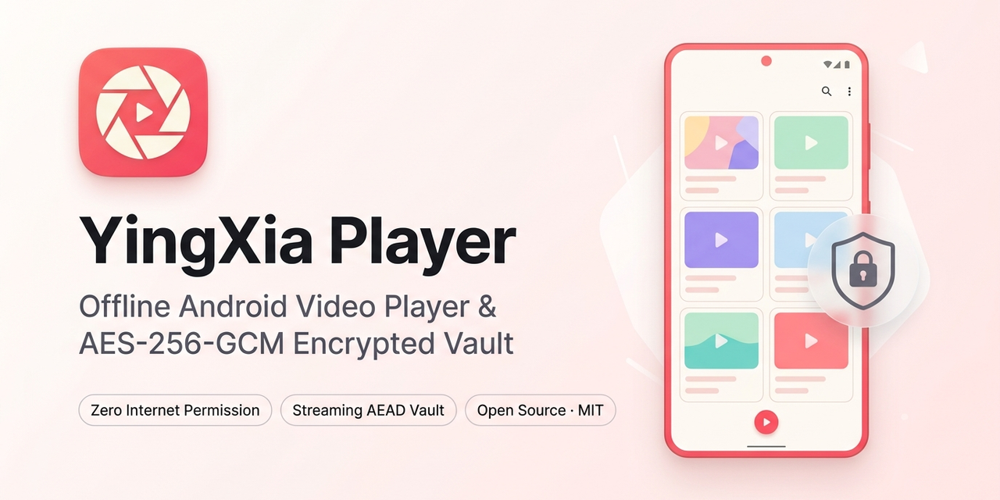
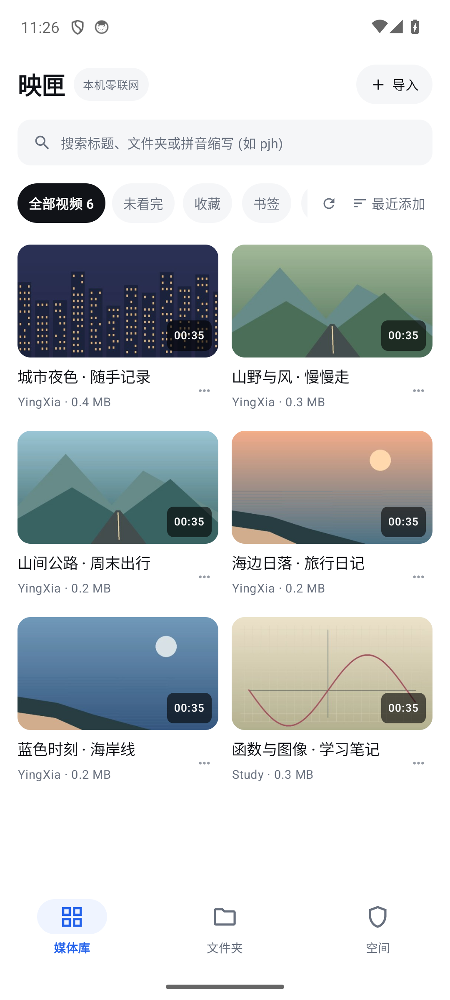
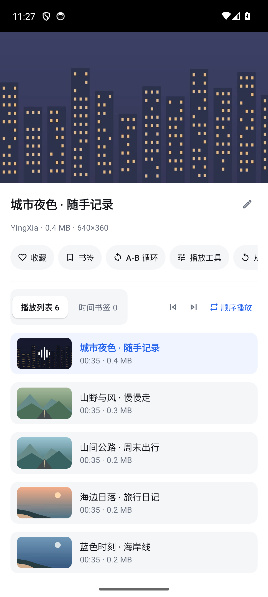
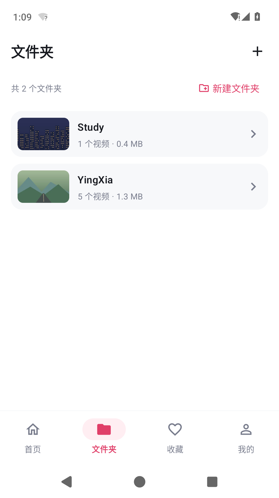
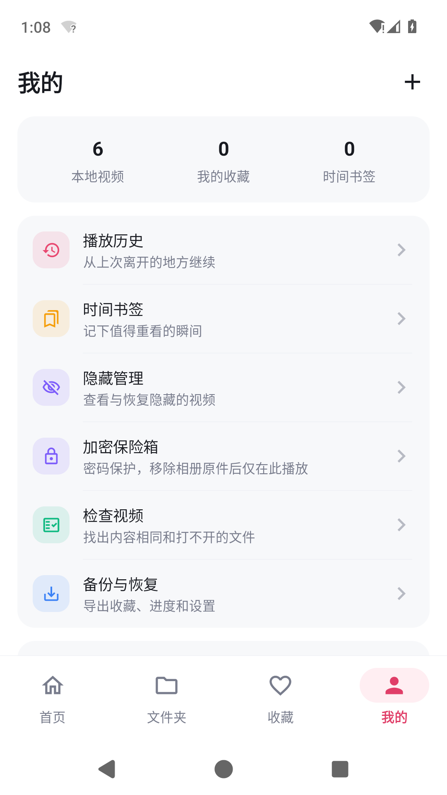
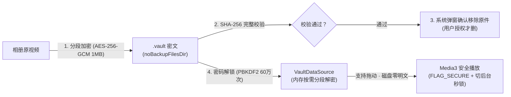

<div align="center">



# 映匣 · YingXia Player

**零联网权限 · 本地 AES-256-GCM 流式加密视频保险箱 · 清爽无广告的 Android 本地视频播放器**

[English](README.md) · **简体中文**

[](https://github.com/QAQ-cmyk/yingxia-player/releases/latest)
[](https://github.com/QAQ-cmyk/yingxia-player/actions/workflows/android.yml)
[](scripts/check-apk-privacy.py)
[](LICENSE)
[](https://github.com/QAQ-cmyk/yingxia-player/releases/latest)

[📥 下载最新 APK](https://github.com/QAQ-cmyk/yingxia-player/releases/latest) · [🌐 项目官网](https://qaq-cmyk.github.io/yingxia-player/) · [🔐 保险箱安全设计](docs/加密保险箱.md) · [📋 更新日志](CHANGELOG.md) · [🛡️ 安全政策](SECURITY.md)

</div>

---

## 为什么做映匣？

市面上绝大多数「私密视频保险箱 / 隐藏相册」App 都有让人头疼的问题：**满屏开屏广告、强制注册登录、申请联网权限、付费订阅，甚至只是改文件后缀名或建 `.nomedia`“假隐藏”**；而系统自带相册会把录屏、网课混在海量照片里，还缺少倍速、A–B 循环和时间书签等顺手的本地播放工具。

**映匣（YingXia Player）** 是一款干干净净、完全离线、经得起源码审查的开源 Android 本地视频播放器（**Kotlin / Jetpack Compose / Media3 / Google Tink**）：

| 对比项 | 系统相册 | 常见商业“隐藏相册” App | **映匣 (YingXia Player)** |
| --- | :---: | :---: | :---: |
| 联网权限 / 广告 / 遥测 | 常绑定云同步 | 多含广告 SDK 与联网权限 | **零联网权限 · 零广告 · 零账号**（CI 自动校验） |
| 私密视频保护方式 | 依赖云端或系统私密空间 | 常见改后缀/隐藏目录或收费 | **Google Tink AES-256-GCM 真流式加密** |
| 加密视频播放方式 | — | 常先解密出明文临时文件 | **按需分段内存解密播放，不落明文缓存** |
| 观影 / 网课播放工具 | 基础播放 | 往往简陋 | **8 档倍速、长按 2×/3×、A–B 循环、时间书签、睡眠定时** |
| 开源可审计 | 闭源 | 闭源 | **MIT 完全开源** + 自动 APK 隐私校验脚本 |

---

## 界面一览

| 首页 · 纯净双列视频库 | 播放 · 手势与队列 | 文件夹 · 真实目录管理 | 我的 · 保险箱与体检 |
| :---: | :---: | :---: | :---: |
|  |  |  |  |

---

## 加密保险箱是如何工作的？

不同于许多“加密软件”播放前先把整个视频解密成明文临时文件，映匣通过自定义 Media3 `VaultDataSource` 直接对接 **Google Tink `AES256_GCM_HKDF_1MB` Streaming AEAD** 随机读取解密通道：



- **PBKDF2-HMAC-SHA256（600,000 次迭代）** 封装独立 Tink keyset，密码和明文密钥绝不落盘。
- **先加密校验，再请求移原件**：完整加密、fsync 落盘并 SHA-256 复核通过后，才调用 Android 系统弹窗请你确认移除相册原件；拒绝或中断都不会误删原文件。
- **元数据隔离 & 零明文缩略图**：箱内名称、续播进度、收藏、裁黑边和时间书签独立 AAD 认证加密保存（`.meta` / `.playback`），绝不泄露到普通搜索、历史或 JSON 备份。
- **防窥防截屏 & 播放中一键锁箱**：页面启用 `FLAG_SECURE` 防截屏录屏，切到后台立即锁箱；播放加密视频时点右侧「锁箱」（全屏/防误触下同样可用）瞬间静音、锁箱并返回首页。
- **零相册库权限也能用（相册分享直达）**：即使拒绝授予完整视频库读取权限，也可直接在系统相册选中视频点「分享 → 映匣」，直接无痕观看或保存加密副本到保险箱。
- **离线自拟三道密保问题**：可选基于 Android Keystore 加密保存三道自拟密保题（5 次错误自动冷却），忘记密码时可在原手机离线重设，全程零联网。

深入技术细节：[docs/加密保险箱.md](docs/加密保险箱.md) · [English Architecture Doc](docs/VAULT_ARCHITECTURE.md)

---

## 播放与本地资料库功能

- **顺手控速与手势**：`0.25×`–`3×` 八档变速、**长按画面临时 2×/3× 加速（松手恢复）**、双击播放/暂停、横向拖动精准预览定位、全屏左亮度右音量、双指捏合缩放、裁黑边、播放防误触锁屏。
- **网课与私密观看神器**：**A–B 区间循环**、**时间书签备注**（普通列表与加密保险箱均独立支持）、**本次不记播放记录**（从头观看、不污染历史与原续播进度）以及**睡眠定时**（倒计时或播完当前暂停）。
- **离线资料库工具**：**中文拼音首字母搜索**（如输 `pjh` 搜「啤酒花」）、SHA-256 校验后真实移动本机文件夹、离线重复/坏文件体检、纯文本 JSON 记录备份与恢复。
- **完整中英双语界面**：支持跟随系统或在 **我的 → 播放与外观** 中一键切换 **简体中文 / English**。

---

## 自己验证「零联网权限」

发布 APK 在 [`AndroidManifest.xml`](app/src/main/AndroidManifest.xml) 中显式移除了 `INTERNET` 和 `ACCESS_NETWORK_STATE`，并禁用了 `allowBackup` 和 `fullBackupContent`。每次提交都会在 [GitHub Actions](.github/workflows/android.yml) 自动检查，你也可以在本地直接验证任意发行版 APK：

```bash
python3 scripts/check-apk-privacy.py YingXia-1.8.0.apk
# PASS: network permissions absent; backup disabled; extraction rules declared; debugging disabled.
```

<details>
<summary><strong>隐私与安全边界（存放重要视频前请务必阅读）</strong></summary>

| 你做的操作 | 手机上会发生什么 |
| --- | --- |
| **普通播放或隐藏** | 视频留在原文件夹。普通「隐藏」只从映匣列表过滤，系统相册仍可见，随时可恢复。 |
| **移入加密保险箱** | 视频、名称与箱内播放记录加密存入 `noBackupFilesDir`；取消系统移除授权时相册仍保留原件。 |
| **忘记保险箱密码** | 输错密码不会删除文件。提前开启本机三题密保后，可在原手机离线重设密码；未提前开启时无法绕过密码。 |
| **卸载或换机** | 系统云备份与设备迁移均已禁用，**卸载或清空应用数据会删除保险箱**。换机前请先解锁并点「恢复到相册」（导出到 `Movies/映匣恢复/`）。 |

</details>

---

## 安装与更新

- **GitHub Releases 直接下载**：前往 [**最新版本页面**](https://github.com/QAQ-cmyk/yingxia-player/releases/latest) 下载正式签名的 `YingXia-*.apk` 与 `SHA256SUMS`（Android 8.0+）。**从旧版升级请直接覆盖安装**，切勿先卸载以免删除保险箱。
- **Obtainium 自动追更**：在 [Obtainium](https://github.com/ImranR98/Obtainium) 中添加 `https://github.com/QAQ-cmyk/yingxia-player` 即可自动检测更新。
- **IzzyOnDroid / F-Droid**：已就绪标准 Fastlane 元数据与无专有依赖块构建配置，准备上架中。
- **从源码构建**：需要 JDK 17 与 Android SDK 35，详见 [CONTRIBUTING.md](CONTRIBUTING.md)。

---

## 路线图（Roadmap）

点一颗 **Star ⭐** 关注后续版本更新：

- [x] 零联网权限 + CI 自动化隐私清单校验
- [x] AES-256-GCM 流式加密视频保险箱（内存按需解密、零明文缓存）
- [x] 离线自拟三道密保问题（Android Keystore）
- [x] 完整中英双语界面与应用内一键语言切换
- [x] Fastlane 商店元数据与纯净 FOSS 构建配置
- [ ] 保险箱生物识别（指纹 / 面部）快捷解锁
- [ ] 外挂字幕支持（`SRT` / `VTT` / `ASS`）
- [ ] 加密保险箱离线换机导出包
- [ ] 上架 IzzyOnDroid 与 F-Droid

---

## 参与贡献

欢迎提交设备实测反馈、Bug 报告、功能建议与 Pull Request：

- [报告问题或提交功能建议](https://github.com/QAQ-cmyk/yingxia-player/issues/new/choose)
- [构建与贡献指南](CONTRIBUTING.md) · [安全反馈政策](SECURITY.md)

如果映匣让你重新拥有了一款清爽无广告的本地播放器，或者帮你安心存好了私密视频，欢迎在右上角点个 **Star ⭐** 支持一下！
